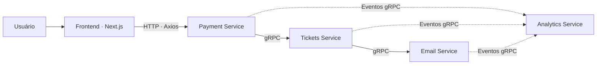

# Sistema Distribuído de Venda de Ingressos

Projeto acadêmico de venda de ingressos desenvolvido com **arquitetura de microsserviços**, comunicação **HTTP e gRPC**, conteinerização com **Docker** e orquestração com **Kubernetes**. O sistema também demonstra **escalabilidade horizontal automatizada** por meio de um **Horizontal Pod Autoscaler (HPA)** baseado no consumo de memória.

Desenvolvido no contexto da disciplina **CIN0143 — Introdução a Sistemas Distribuídos e Redes de Computadores**, do **Centro de Informática da Universidade Federal de Pernambuco (CIn/UFPE)**.

> **Escopo acadêmico:** pagamentos e envios de e-mail são simulados; a aplicação não efetua cobranças reais nem persiste transações.

## Visão geral

A aplicação contém um frontend em **Next.js** e quatro microsserviços em **Node.js**. O frontend inicia o checkout por HTTP utilizando Axios; a sequência entre os serviços de backend é síncrona e utiliza gRPC, com contratos definidos em Protocol Buffers.

### Arquitetura



| Componente | Responsabilidade | Porta |
| --- | --- | --- |
| `frontend` | Interface de compra e envio da solicitação HTTP | `3000` |
| `payment-service` | Processamento simulado do pagamento e coordenação do checkout | `8000` (HTTP) |
| `tickets-service` | Geração de identificadores únicos para os ingressos | `8001` (gRPC interna) |
| `email-service` | Simulação de envio de confirmação por e-mail | `8002` (gRPC interna) |
| `analytics-service` | Registro de eventos de pagamento, ingresso e e-mail nos logs | `8003` (gRPC interna) |

### Fluxo de compra

1. O frontend envia os dados da compra ao `payment-service` por HTTP.
2. O pagamento é simulado e um evento é enviado ao `analytics-service` por gRPC.
3. O `payment-service` chama o `tickets-service`, que gera um identificador UUID para o ingresso.
4. O `tickets-service` solicita ao `email-service` a confirmação simulada.
5. Os serviços registram eventos no `analytics-service`, e a resposta consolidada retorna ao frontend.

Os contratos gRPC estão em [`proto/checkout.proto`](proto/checkout.proto) e [`proto/health.proto`](proto/health.proto).

## Tecnologias e conceitos

- **Next.js e Node.js:** interface web e microsserviços.
- **HTTP, Axios, gRPC e Protocol Buffers:** comunicação entre componentes.
- **Docker e Docker Compose:** criação e execução dos contêineres em ambiente local.
- **Kubernetes:** Deployments, Services, verificações de saúde e gerenciamento de réplicas.
- **Horizontal Pod Autoscaler (HPA):** escalabilidade do serviço de pagamento por uso de memória.
- **GitHub Actions:** verificação automatizada das entregas acadêmicas.

## Executando localmente com Docker Compose

**Pré-requisitos:** Docker e Docker Compose instalados. A primeira construção das imagens exige acesso à internet.

Na raiz do repositório, execute:

```bash
docker compose up --build
```

Acesse **http://localhost:3000** e utilize o botão **Confirm & Pay** para simular uma compra.

Para acompanhar os eventos gerados:

```bash
docker compose logs -f analytics-service
```

Para encerrar e remover os contêineres:

```bash
docker compose down
```

O processamento simulado inclui atrasos artificiais, resultando em aproximadamente nove segundos para uma compra normal.

## Implantação e escalabilidade no Kubernetes

A configuração Kubernetes está no diretório [`k8s/`](k8s/), com manifests para os cinco componentes da aplicação e um HPA exclusivo do serviço de pagamento.

| Configuração | Valor |
| --- | --- |
| Serviço escalável | `payment-service` |
| Recurso monitorado | Memória |
| Métrica do HPA | `AverageValue` |
| Alvo médio | `35Mi` |
| Réplicas mínimas | `1` |
| Réplicas máximas | `3` |
| Demais componentes | `1` réplica cada |

**Pré-requisitos:** cluster Kubernetes configurado e acessível via `kubectl`, além das dependências exigidas pelos scripts acadêmicos. Os comandos abaixo pressupõem o ambiente da disciplina preparado, incluindo o cluster `cin0143`.

```bash
# Preparar os serviços no cluster
python3 tests/entrega-2/setup_k8s.py

# Instalar e aguardar o Metrics Server
kubectl apply -f tests/entrega-3/metrics-server.yaml
kubectl -n kube-system rollout status deployment/metrics-server --timeout=180s

# Aplicar os manifests e inspecionar o estado
kubectl apply -f k8s/
kubectl get deployments
kubectl get hpa
```

A avaliação de escalabilidade pode ser executada com o cluster preparado:

```bash
python3 tests/entrega-3/test_autoscaling.py
```

Durante os testes, o HPA elevou a quantidade de réplicas disponíveis do serviço de pagamento em resposta à carga. O avaliador confirmou a conclusão das compras, o scale-up e a ausência de reinícios ou eventos `OOMKilled`. As três entregas também tiveram execução bem-sucedida nos workflows de avaliação do GitHub Actions da disciplina.

## Organização do repositório

```text
frontend/          Interface web em Next.js
microservices/      Serviços de pagamento, ingressos, e-mail e analytics
proto/             Contratos Protocol Buffers para comunicação gRPC
k8s/               Deployments, Services e HPA do Kubernetes
tests/             Testes e infraestrutura de avaliação acadêmica
requisitos/        Enunciados das entregas
compose.yaml       Orquestração local com Docker Compose
```

### Histórico das entregas

| Branch | Evolução do projeto |
| --- | --- |
| `main` | Código-base e contratos iniciais |
| `entrega-1` | Comunicação gRPC entre microsserviços |
| `entrega-2` | Implantação da aplicação no Kubernetes |
| `entrega-3` | Escalabilidade horizontal com HPA baseado em memória |
| `portfolio` | Apresentação e documentação da versão final |

As branches das entregas permanecem preservadas para consulta ao desenvolvimento incremental e ao histórico de commits.

## Limitações e decisões de projeto

Esta implementação foi criada para estudar sistemas distribuídos, não para operar comercialmente. A autenticação é simulada; pagamentos e e-mails não são reais; os dados não são persistidos; e os eventos de analytics são registrados na saída padrão. O checkout usa chamadas síncronas, sem tentativas automáticas, deadlines ou transações distribuídas. Essas decisões permitem observar os efeitos de falhas parciais e o acoplamento entre serviços.

## Autoria e créditos

Projeto desenvolvido como atividade acadêmica em equipe na disciplina **CIN0143 (CIn/UFPE)**. A estrutura e os materiais acadêmicos originais foram fornecidos no contexto da disciplina; a evolução das entregas está registrada no histórico de commits, preservando a autoria de cada contribuição.

O arquivo [`LICENSE`](LICENSE) mantém a licença **MIT** e o aviso de copyright original de **Miguel Oliveira (2026)**.
